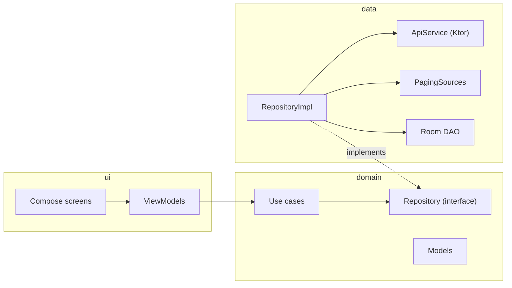

# Rick & Morty KMP

An Android and iOS app built with Kotlin Multiplatform and a single Compose Multiplatform UI, on top of the public [Rick and Morty API](https://rickandmortyapi.com).

<table>
  <tr>
    <th></th>
    <th>Android</th>
    <th>iOS</th>
  </tr>
  <tr>
    <td>Episodes</td>
    <td></td>
    <td></td>
  </tr>
  <tr>
    <td>Characters</td>
    <td></td>
    <td></td>
  </tr>
  <tr>
    <td>Character detail</td>
    <td></td>
    <td></td>
  </tr>
</table>

## Features

- **Episodes:** a paginated, horizontally scrolling list with a progress bar. Tapping an episode plays a clip for its season, with the YouTube player on Android and a `WKWebView` on iOS (iOS playback is still in progress).
- **Characters:** a paginated grid that opens with a *character of the day*. It is picked at random once a day and stored in Room, so it stays the same across restarts.
- **Character detail:** status, species, gender, origin and the episodes the character appears in.
- **Splash screen** on both platforms.

## Tech stack

| Area | Library |
|---|---|
| UI | Compose Multiplatform, Material 3 |
| Navigation | Navigation Compose |
| Dependency injection | Koin |
| Networking | Ktor client (OkHttp on Android, Darwin on iOS) and kotlinx.serialization |
| Pagination | Paging 3 |
| Persistence | Room (Kotlin Multiplatform) with bundled SQLite |
| Images | Coil 3 |
| Dates | kotlinx-datetime |
| Video | [android-youtube-player](https://github.com/PierfrancescoSoffritti/android-youtube-player) on Android, `WKWebView` on iOS |

## Architecture

One `composeApp` module, split into layers by package. Each screen follows MVVM: a ViewModel exposes the screen state as a `StateFlow`.



- `ui` depends on `domain`, never on `data`.
- `data` implements the `Repository` interface that `domain` defines, and maps its DTOs and Room entities to domain models.
- `domain` does not depend on `ui` or `data`.
- Koin wires the layers together (`dataModule`, `domainModule`, `uiModule` and a `platformModule`).
- Platform code goes through `expect`/`actual`: the Room database builder, the Koin platform module and the video player.

```
composeApp/src
├── commonMain    shared UI, domain and data
├── androidMain   Android entry point, Room builder, YouTube player
└── iosMain       iOS entry point, Room builder, WKWebView player
iosApp/           Xcode project that hosts the shared UI
```

## Running the app

You need JDK 17 or 21 and a recent Android Studio. For iOS you also need a Mac with Xcode 16 or later. The API is public, so there are no keys to set up.

**Android:** run the `composeApp` configuration from Android Studio, or:

```bash
./gradlew :composeApp:installDebug
```

**iOS:** open `iosApp/iosApp.xcodeproj` in Xcode and run it on a simulator. Xcode builds the shared framework through Gradle. To run it on a device, pick your own team under *Signing & Capabilities*.

## Credits

Data comes from the [Rick and Morty API](https://rickandmortyapi.com). *Rick and Morty* belongs to its creators and Adult Swim; this is a non-commercial learning project.
